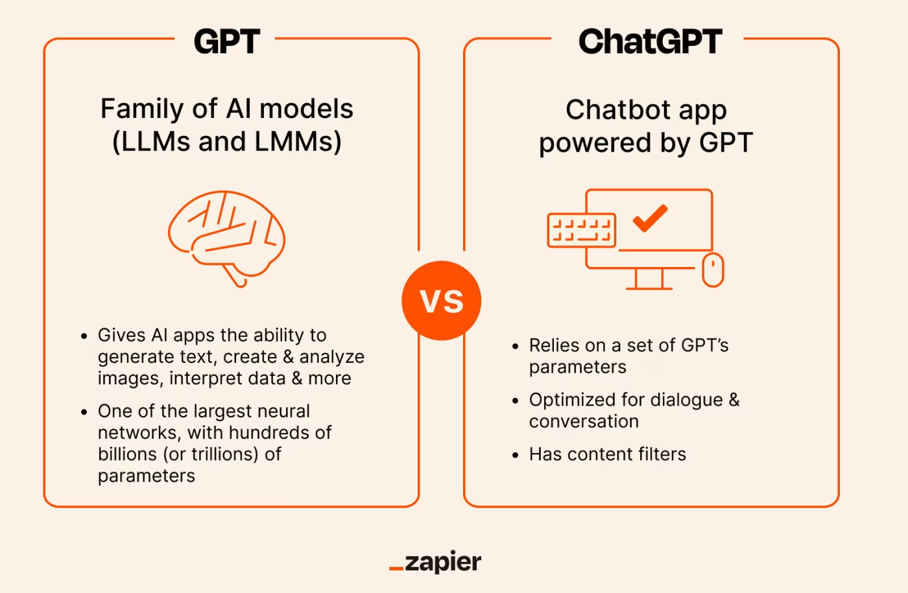

# Large Language Models (LLMs) for Exploratory Research

Welcome to the LLMs for Exploratory Research workshop.

In the fast-evolving AI landscape, LLM-based AI tools such as ChatGPT, Claude, and Gemini have become used throughout all aspects of life. In the research community, their advantages and pitfalls are hotly debated. 

In this workshop, our main goal will be to understand how LLMs can be used by researchers to conduct early-stage, exploratory research. Throughout the workshop, we will discuss best practices for prompt engineering and heuristics to evaluate the suitability of an LLM's output for our research purposes. Though the workshop primarily focuses on early-stage research, we will briefly discuss the use cases of LLMs in later stages of research, such as data analysis and writing.

## Learning Objectives

Our goals for today's workshop are:

1.  Explore different chatbots powered by Large Language Models (LLMs).

2.  Explore use cases for LLMs in exploratory research.

3.  Compare and contrast output from different LLMs.

Throughout this workshop series, we will use the following icons:

🔔 **Question**: A quick question to help you understand what's going on.

🥊 **Challenge**: Interactive exercise. We'll go through these in the workshop!

⚠️ **Warning**: Heads-up about tricky stuff or common mistakes.

💡 **Tip**: How to do something a bit more efficiently or effectively.

📝 **Poll**: A zoom poll to help you learn.

🎬 **Demo**: Showing off something more advanced so you know what you can use LLMs for in the future

## Introduction

We are probably all familiar with ChatGPT which uses an LLM called GPT, either having used it ourselves or heard about it.

💡 **Note:** There is a difference between an LLM and an LLM-powered chatbot [(Source: Zapier)](https://zapier.com/blog/chatgpt-vs-gpt/).

There are several LLMs beyond GPT that can be useful for research.

🔔 **Question**: What is your current favorite LLM chatbot?

In today's workshop, we will explore a handful of LLMs that can be used through chatbots on the internet and do not require local installation. Note that most of these have free versions with limited capabilities and to access the full host of features, paid subscriptions are required. We will be working with free versions of most LLMs.

We will explore the interface of the following LLM-powered AI chatbots in today's workshop:

-   ChatGPT (uses GPT)

-   Claude.ai

-   Google Gemini

Note that these are only four of several chatbots powered by different LLMs. Many others, such as Meta's Llama and Microsoft Copilot, can be used for various research tasks as well.

In today's workshop we will explore the uses of these LLMs following the structure of an exploratory research process.

-   We will start by using an LLM to summarize a research paper.

-   Then, we will design a research question based on the paper we summarize.

-   We will take the help of an LLM to come up with a potential research design to answer our research question.

-   We will end with using an LLM to come up with a structure for our research paper.

Throughout the workshop, as you write your own queries and experiment with different LLMs, make sure to share your suggestions and tips in the chat for how to write the most effective queries for an LLM to give the best output.

## A Note on Getting the Most Out of LLMs for Research

Before diving into the stages of exploratory research, here are a few practical tips for getting the best results from LLM chatbots:

-   **Use extended thinking**: Most major LLMs now offer an extended thinking or reasoning mode (e.g., "thinking" in Claude, "reasoning" in ChatGPT). When enabled, the model spends more time breaking down your question before responding, which leads to more thorough and accurate answers. For research tasks — especially ones involving nuanced analysis or multi-step reasoning — always turn this on.

-   **Verify that web search is enabled**: Many chatbots can search the web in real time, but this feature is not always on by default. When asking about recent findings, specific papers, or the current state of a field, make sure web search is active so the model draws on up-to-date sources rather than relying solely on its training data. When web search is used, most chatbots will show you the sources they drew from — make sure to check that these sources are reputable and relevant before trusting the output.

-   **Consider deep research tools**: ChatGPT, Claude, and Gemini all now offer a "deep research" mode that autonomously browses dozens to hundreds of sources over several minutes and produces a comprehensive, citation-backed report. These are especially useful for literature reviews and scoping the state of a field, and can serve as a strong starting point for your own exploration.

## Stage 1: Framing a Research Question

There are many different ways to choose a research question - you may start with a dataset, an empirical observation about the world, or two variables that seem to be associated with each other. Being able to articulate a precise research question, regardless of where you start, is important for a strong introduction to any paper.

🔔 **Question**: How do you usually come up with research questions in your field?

Before developing a research question, let's get a summary of the paper we will be referencing throughout today's workshop. The paper by Gerber, Green, and Larimer (2008) is one of the most cited papers in the political science field. It asks whether social norms can increase voter turnout during elections and is based on a large-scale experiment conducted in the United States.

### 🎬 **Demo 1a:** Summarizing a research paper

I will upload the paper by Gerber, Green, and Larimer (2008) to an LLM and ask it to summarize the paper for me. To ensure the most useful output, one possible model to follow is asking the LLM for the paper's: research question, argument, hypotheses, methods, and results.

### 🥊 Challenge 1a: Summarizing Papers

Upload a paper from your field to both ChatGPT or another LLM and compare the outputs from the two LLMs when you ask them to summarize the paper for you. Which output has more detail and specificity? Which LLM gave you a faster output? If you wanted more specificity from either LLM, what could you change about your prompt? If you do not have a paper from your field, you can use the paper by Gerber, Green, and Larimer (2008).

💡 **Tip**: The way you write your queries can determine the output from the LLM. Here are some resources from companies that have designed [LLMs](https://platform.openai.com/docs/guides/prompt-engineering) and LLM-based [chatbots](https://www.perplexity.ai/hub/faq/prompting-tips-and-examples-on-perplexity) on [prompt engineering](https://github.com/dair-ai/Prompt-Engineering-Guide), which has become a whole [industry](https://www.promptingguide.ai/) in itself. In the context of summarizing a paper from your field, how do you get these models to give you the most relevant information?

Now that you have a summary of the paper and know its main argument and findings, let's try to develop a research question. One of the best ways to develop a research question is to build upon existing reference sources. In your research process, this would involve reading multiple papers and finding what's called a "gap in the literature" that your research would fill.

### 🎬 **Demo 1b:** Finding a gap/limitation from a paper

On a smaller scale, let's first look at how you might use an LLM to find such a gap using the Gerber, Green, and Larimer paper!

### 🥊 Challenge 1b: Designing a Research Question with LLMs

Using an LLM (you can choose between ChatGPT, Perplexity Pro, Claude.ai, and Google Gemini), come up with a research question that addresses any gaps in the literature or limitations based on the findings in the paper that you chose for the previous challege.

💡 **Tip**: When doing your research, you could summarize several individual papers like this by uploading them. You could then create a spreadsheet of all the papers you’ve read and then upload the spreadsheet to an LLM to give you a summary of the field, identify the gaps in the literature, and find a suitable research question!

### 🎬 **Demo 2**: Running a search on Consensus

There are some AI-powered research tools, such as [Consensus](https://consensus.app/?home=true), that draw from research libraries and can be a starting point for finding papers and summarizing existing literature on your topic. Consensus searches over 200 million peer-reviewed academic papers hosted on Semantic Scholar and summarizes findings to present links to papers on a topic. You can also integrate Consensus directly into the chatbots we've been using: it is available as a [custom GPT in ChatGPT](https://chatgpt.com/g/g-bo0FiWLY7-consensus) (requires ChatGPT Plus) and as an [MCP connector in Claude](https://consensus.app/home/mcp/), allowing you to search academic literature without leaving your conversation. Let's see what happens when I run a query on a topic I am familiar with!

💡 **Tip**: Make sure to always double check the output from any LLM. Your existing knowledge about a topic will come in handy to ensure that the output for your query is accurate!

## Stage 2: Testing the Research Question

Once you have determined a research question and situated it within the broader literature on the topic, you will need an effective research design to test the research question. The research design is a plan that outlines the methodologies you will use to answer your research question and test the hypotheses related to your research question. LLMs can be very helpful in coming with potential research designs.

Coming up with a research design that effectively tests hypotheses related to your research question depends on your field of study and your specific research question. It will look different if your research is primarily in the lab, in an archive, or among survey respondents. Though we will not focus in-depth on research methods in this workshop, here are a few guides (of hundreds!) that can be a starting point for your research:

-   A social science research-specific [guide](https://digitalcommons.usf.edu/cgi/viewcontent.cgi?article=1002&context=oa_textbooks) for research best practices.

-   A [paper](https://pmc.ncbi.nlm.nih.gov/articles/PMC9223329/) on best research practices in STEM and lab-related research.

-   [Handbook](https://sk.sagepub.com/reference/the-sage-handbook-of-research-methods-in-political-science-and-ir) on research methods in political science and international relations.

To get a head start on what the research design could look like, we can take the help of LLMs. This query can be as simple as "what does a potential research design for the following question look like" and can become more specific based on your domain knowledge.

### 🎬 **Demo 3:** Drawing a research design

Let's ask an LLM to give us a research design for the following question: “How do social pressure effects vary based on the source of the intervention (e.g., government agencies, non-partisan organizations, political parties)?” This was one of the questions it suggested for the prompt asking for a potential research question drawn from the Gerber, Green, and Larimer (2008) paper.

### 🥊 Challenge 2: Research Design Preparation

Using an LLM of your choice, come up with a potential research design for one of the research questions from Challenge 1b. Here are some questions to guide your assessment of the LLM's output:

-   What level of detail does it provide? For instance, does it tell you the sample size of your study? Does it suggest you should pre-register the study?

-   Does it tell you what research methodologies you would need to use and how to execute them?

-   What would you need to change or adapt from the output of the LLM when you implement the design for your paper?

LLMs (so far) will not be able to replace your expertise as a researcher, so make sure to cross-reference the output with resources specific to your field of study. Many LLMs now support "memory," meaning they can retain context from previous conversations to act more like a research assistant familiar with your field of study. Most chatbots also allow you to create projects (e.g., ChatGPT Projects, Claude Projects) that segment memory and uploaded files by topic, so you can maintain separate contexts for different research threads.

## Stage 3: Structuring a Paper

Before looking for data and conducting analysis for your research question, you might want a structure for your research paper to ensure it will flow correctly. Perhaps, you have a paper in your field of study that you particularly like. You can ask an LLM to analyze the structure of that paper and use it for your own.

### 🎬 Demo 4: Analyzing the structure of a paper 

Let's head over to an LLM to ask it for an analysis of the structure of the Gerber, Green, and Larimer (2008) paper. I will ask the LLM to cross-reference the structure of this paper with publication requirements at top political science journals as well.

### 🥊 Challenge 3: Asking an LLM to Analyze Paper Structure

Using the same paper you uploaded previously from your field, ask an LLM of your choice to analyze the structure of that paper. Make sure to specify the level of detail you want in the output. For instance, do you want the LLM to give you broad section headers? Do you want the output to include how the structure could be adapted to your research question? You may need to use multiple queries to address this challenge!

💡 **Tip**: Make sure to think about how you would change the structure of the paper to suit your needs, for instance, a journal's requirements for a submission.

## Post-Exploratory Phase of Research

There are plenty of other use cases for LLMs in research beyond the exploratory phase. Most commonly, researchers use LLMs to assist them in coding, which includes debugging code or writing code more efficiently, or even learning about a new package or new language. Beyond simple code assistance, a growing trend is **agentic coding** — using LLM-powered tools like [Claude Code](https://docs.anthropic.com/en/docs/claude-code), [GitHub Copilot](https://github.com/features/copilot), and [Cursor](https://www.cursor.com/) that can autonomously navigate a codebase, run commands, execute analyses, and iterate on errors. Rather than asking an LLM to write a single function, you can point an agentic coding tool at an entire data analysis pipeline or research codebase and have it build, test, and debug code across multiple files with minimal intervention. This is particularly useful for researchers who need to conduct complex data analyses but may not have deep programming expertise.

It is also increasingly common to use LLMs as a simulated reviewer for your paper. By uploading a draft and asking the model to critique it as a peer reviewer would, you can surface potential holes in your argument, gaps in your methodology, or unclear writing before submission. Of course, it is up to you as the researcher to decide which of these critiques are worth addressing — not every flag the model raises will be relevant or correct.

### Caveats and Considerations

As you incorporate LLMs into your research workflow, keep the following in mind:

-   **Hallucinated citations**: LLMs can fabricate convincing-looking references — complete with plausible author names, journal titles, and DOIs — that do not actually exist. Always verify citations against a database like Google Scholar or your library catalog before including them in your work.

-   **Large context windows**: Modern LLMs can process very long inputs (100,000 tokens or more), which means you can upload multiple papers in a single conversation rather than summarizing them one at a time. This makes it much easier to ask an LLM to compare findings across papers or synthesize a body of literature. However, LLMs may still lose track of details in very long contexts, so it is a good practice to ask targeted follow-up questions about specific sections. Projects (mentioned earlier) are helpful here: they let you maintain a consistent context across conversations, so if your current chat or analysis gets too long, you can start a new chat within the same project without losing that shared background.

-   **Privacy**: Some companies behind LLMs, such as OpenAI, retain access to user conversation logs, and recent court rulings have reinforced that this access may be perpetual. Avoid uploading sensitive, private, or personally identifiable information to any LLM chatbot. Note that UC Berkeley affiliates have access to Google Gemini through the university's institutional agreement, which permits use with up to P3 protected data — this data will not be used for model training or any other purpose beyond your session.

-   **Copyright and licensing**: Whether you can upload a paper to a chatbot depends on the paper's licensing. Many academic papers are published under Creative Commons licenses that may permit this, but many are not. You are responsible for ensuring you have the right to upload content. If you are unsure, contact the paper's authors or publisher for permission.

-   **Citation of LLM use**: Norms around citing LLM use in research are still evolving, but some conferences and journals are starting to require explicit LLM disclosures. You should be prepared to acknowledge your use of LLMs, including explaining how the tools were applied (e.g., polishing writing, identifying related work, debugging code). Check the submission guidelines for the relevant conference or journal before submitting.

## Key Points

LLMs are a powerful tool if used correctly by researchers. In this workshop, we discussed the use of LLMs and AI-powered chatbots in conducting early-stage research. Specifically, we covered using LLMs to:

-   Come up with research questions drawn from the shortcomings or as extensions of existing work.
-   Summarize existing papers on a topic of interest.
-   Create a research design that will help test the research question.
-   Structure a research paper in the most effective way by asking the model to analyze the structure of a paper that we would like to emulate.

⚠️ **Heads-up**: Remember, the output of a model is only as good as the input we provide, which means to get the best out of an LLM, we need to ask the right questions and always remember to check the output. Your knowledge as a researcher is invaluable because LLMs can still give us incorrect or incomplete answers!
